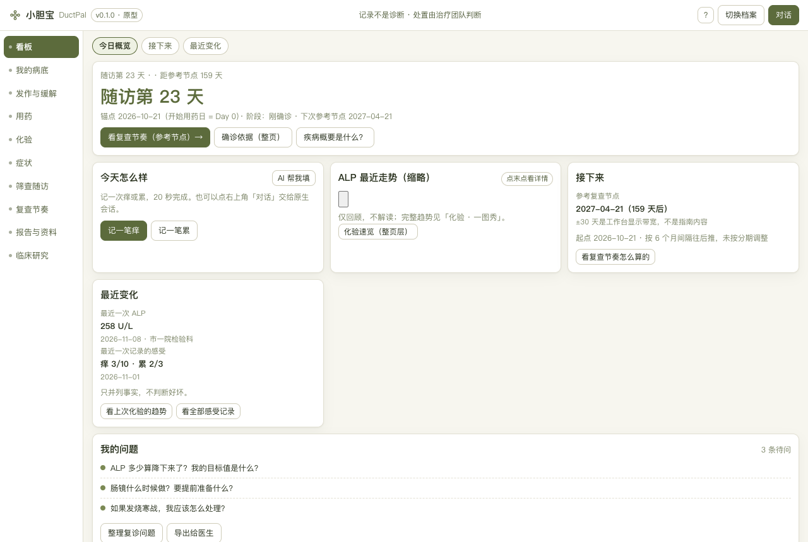
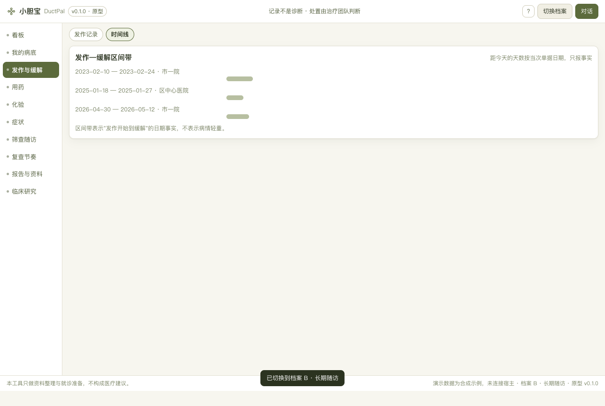
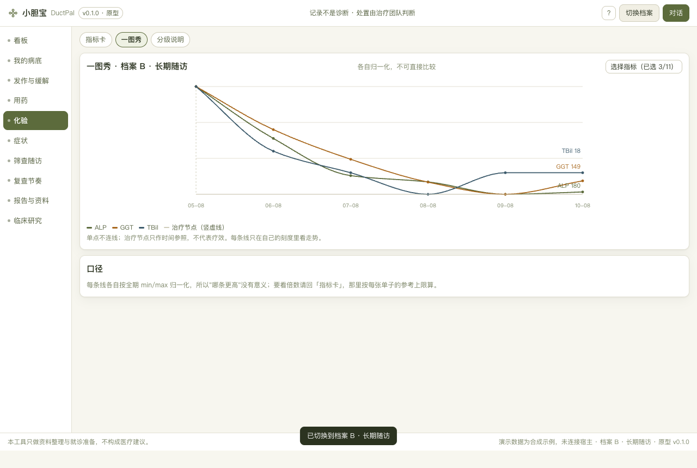
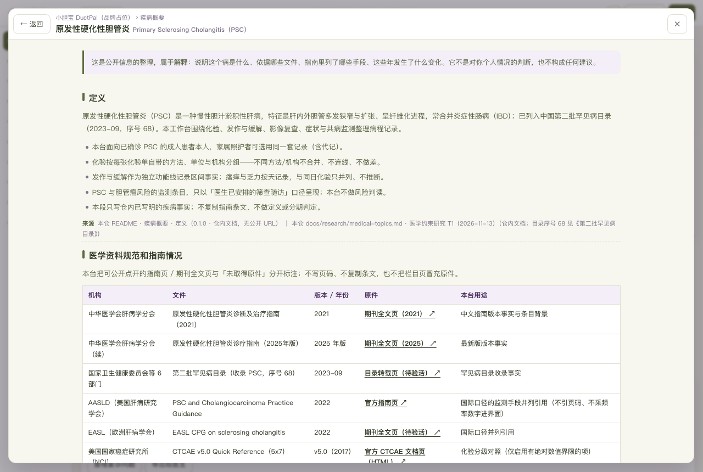
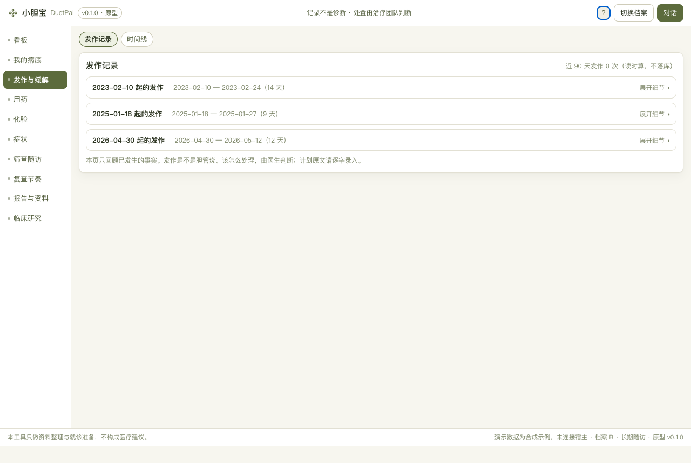
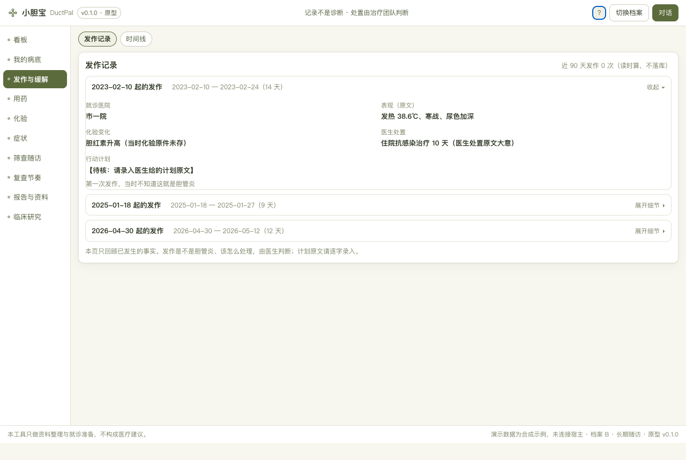

# 小胆宝 DuctPal 原发性硬化性胆管炎（PSC）工作台（品牌占位）

本机优先的 PSC 确诊档案、肝功能化验随访、胆管炎发作—缓解记录、MRCP/肠镜筛查随访、瘙痒乏力症状与用药、复诊材料准备工作台。

**0 患者访谈、0 临床审核**（如实标注）；所有医学阈值【待核】；判读归医生。演示数据为合成示例，未连接宿主。

## 疾病概要

原发性硬化性胆管炎（PSC，Primary Sclerosing Cholangitis）是一种慢性胆汁淤积性肝病，已列入中国第二批罕见病目录（序号 68）。本工作台面向已确诊的成人患者本人与家属照护者，围绕四类患者关心的事组织：**化验趋势**（不同方法/机构不合并）、**发作与缓解**（一次发作一个折叠单元）、**筛查随访**（医生已安排的条目，无风险判读）、**症状与用药**（患者语言原文记录）。点顶栏「?」看疾病概要四段（定义 / 医学资料规范和指南情况 / 治疗全景 / 发展趋势），每段带来源行。

## 关键功能（实渲截图，prototypes/v0.2 v0.1.0）

### 看板 · 两套合成档案（A 刚确诊记录少 / B 长期随访发作多，切换整页联动不串档）


档案 A · 刚确诊：随访第 N 天、确诊依据入口、化验速览。


档案 B · 长期随访：8 年随访、3 次发作、3 种用药，切换后全页数据跟着换。

### 发作与缓解 · 区间带（PSC 专属线）


一次发作一条区间带；「近 90 天发作 N 次」读时算、不落库；医生行动计划逐字照录。

### 化验 · 一图秀（不同方法/机构不合并）


ALP/GGT/胆红素三条线各自按全期归一化，末点标注、来源行同屏；单据没印上限就如实留空。

### 疾病概要（整页四段，非肿瘤固定出口）


定义 → 指南情况 → 治疗全景 → 发展趋势；按受累器官与病情轻重排列，不代表任何一项适合你。

### 发作折叠卡 · 收起/展开态



原生 `<details>` 折叠；空态给下一步按钮。

## 怎么用

1. DSH Desktop 安装本包（M6 装机验证进行中；未装机前可直接双击打开 `prototypes/v0.2/index.html` 预览原型）。
2. 顶栏「配置资料目录」选择本机目录（主目录/桌面/下载根/tmp 不作资料目录）。
3. 「＋ 新建档案」建立自己的档案；演示档案标「[演示]」，只读可切换。
4. 顶栏「AI 对话」走宿主原生会话；页面内「和 AI 讨论」按钮把本页关键信息填进输入框草稿（只填不发）。

## 数据与口径

- 演示数据唯一源：`demo/build-demo-data.mjs` → `prototypes/v0.2/demo-data.js`（重跑 `node demo/build-demo-data.mjs`）。
- 真实库：SQLite（`schema/0001_initial.sql`，19 表，冻结 sha256 见 `schema/freeze-contract.md`）。
- 私密三出口（看板摘要/导出/AI 上下文）共用同一过滤函数；更正=新增版本，不覆盖。
- 临床试验线：`research/psc/` 快照 220 条（manifest=jsonl=sqlite 三处对账一致）；chictr_online 失败如实记录于 `research/psc/FAILED.md`。
- 全站口径：「仅回顾，不解读」「解读归医生」「不同方法不合并」。

## 开发

```bash
npm install
npm run check     # 静态包合同 + 检查链
npm test          # 十套单测
npm run audit     # 家族一致性
```

里程碑与闸口记录见 `PROGRESS.md` 与 `docs/signoffs/`；0 患者访谈、0 临床审核、装机未验证项分别在 `docs/signoffs/` 与晨审报告如实标注。当前版本 0.1.0（原型阶段，v0.1.0 截图）；版本同源链见 `docs/DEV-REQUIREMENTS.md` §七。
